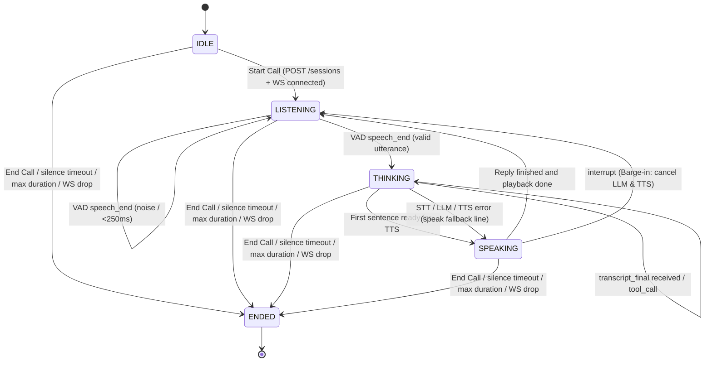

# Real-Time Voice Agent MVP

A production-grade, real-time voice assistant built with Python 3.11+, FastAPI, asyncio, WebSockets, and SQLite. The agent listens to user microphone input in real time, converts speech to text, streams tokens through an LLM (with tool-calling capabilities), synthesizes speech sentence-by-sentence, and streams audio back to the client with sub-1.5s end-to-end latency and full barge-in interruption support.

---

## Architecture Overview

The system follows a modular architecture where every pipeline component is isolated behind strict Python Protocols (`backend/app/adapters/protocols.py`). Provider adapters (mock, local, or cloud) are selected dynamically via configuration and a centralized registry (`backend/app/adapters/registry.py`).

```
CLIENT (Browser)                             BACKEND (FastAPI + Asyncio)
┌────────────────────────┐                   ┌──────────────────────────────────────────────┐
│  Microphone Capture    │ ─── 16kHz PCM ──> │ VAD (Voice Activity Detector)                │
│  (16kHz mono s16le)    │     Frames        │   Detects speech_start & speech_end          │
└────────────────────────┘                   └──────────────────────┬───────────────────────┘
                                                                    │ Audio frames
┌────────────────────────┐                   ┌──────────────────────▼───────────────────────┐
│  Call UI & Captions    │ <─── Events ───── │ Streaming STT Adapter (Mock / Deepgram)      │
│  (Partial & Final)     │   (JSON over WS)  │   Emits partial & final transcripts          │
└────────────────────────┘                   └──────────────────────┬───────────────────────┘
                                                                    │ Final transcript
┌────────────────────────┐                   ┌──────────────────────▼───────────────────────┐
│  Audio Playback Queue  │ <─── Binary ───── │ Streaming LLM (Mock / Groq / Gemini)         │
│  & Barge-in Detector   │      Audio        │   Streams tokens & triggers ToolExecutor     │
└────────────────────────┘      Chunks       └──────────────────────┬───────────────────────┘
            │                                                       │ Token stream
            │ Interrupt (Barge-in)           ┌──────────────────────▼───────────────────────┐
            └──────────────────────────────> │ Sentence Buffer (Cut at . ! ?, skip abbrev)  │
                                             └──────────────────────┬───────────────────────┘
                                                                    │ Complete sentences
                                             ┌──────────────────────▼───────────────────────┐
                                             │ Streaming TTS Adapter (Mock / Piper)         │
                                             │   Synthesizes PCM chunks at 24kHz            │
                                             └──────────────────────┬───────────────────────┘
                                                                    │
                                             ┌──────────────────────▼───────────────────────┐
                                             │ TurnTimer & SQLite Persistence               │
                                             │   (sessions, turns, turn_metrics, errors)    │
                                             └──────────────────────────────────────────────┘
```

---

## Session State Machine

The session enforces strict transitions across 5 core states per design specification:



---

## Key Features

- **End-to-End Streaming Pipeline**: VAD speech detection -> STT streaming -> LLM token generation -> Sentence buffering -> TTS audio streaming without waiting for the full response.
- **Sub-1.5s Latency Budget**: User stops speaking -> first agent audio chunk sent in ~1450 ms (including 600 ms VAD silence wait).
- **Fast Barge-In Support**: Client monitors speech energy while agent is talking; stops playback and cancels server LLM/TTS within ~300 ms. Sentences actually heard are preserved in history.
- **Tool Calling with Error-Safety**: LLM can call external tools (`get_current_time`, `get_order_status`). The `ToolExecutor` wraps calls in timeouts and guarantees never to crash the pipeline.
- **Accurate Per-Stage Latency Measurement**: Monotonic timestamps record exact latencies (`vad_end_ms`, `stt_final_ms`, `llm_first_token_ms`, `tts_first_audio_ms`, `total_ms`).
- **SQLite Persistence**: Complete history of sessions, user/agent turns, turn latency metrics, and stage errors saved to SQLite.
- **Web Interface**: Clean, single-page call interface with microphone capture, visual state badge, live captions (partial + final), and barge-in feedback.

---

## Configuration & Environment Variables

All settings are configured via environment variables or `.env` using Pydantic Settings (`backend/app/config.py`):

| Variable | Default | Description |
|---|---|---|
| `SYSTEM_PROMPT` | `"You are a helpful voice assistant."` | Base system prompt for the conversational LLM. |
| `PROMPT_VERSION` | `"v1.0"` | Version tag recorded with each session. |
| `FALLBACK_LINE` | `"Sorry, I didn't catch that, could you repeat?"` | Fallback phrase spoken when an adapter encounters an error. |
| `VAD_SILENCE_MS` | `600` | Silence threshold in ms before declaring end-of-speech. |
| `VAD_MIN_SPEECH_MS` | `250` | Minimum speech duration in ms (shorter sounds treated as noise). |
| `MAX_CALL_SECONDS` | `600` | Maximum call duration before graceful goodbye and termination. |
| `SILENCE_TIMEOUT_SECONDS` | `120` | Silence watchdog timeout before automatic call close. |
| `STT_TIMEOUT_S` | `3.0` | Timeout in seconds waiting for final STT transcript. |
| `LLM_TIMEOUT_S` | `5.0` | Timeout in seconds waiting for LLM first token. |
| `TTS_TIMEOUT_S` | `5.0` | Timeout in seconds waiting for TTS first audio chunk. |
| `TOOL_TIMEOUT_S` | `5.0` | Timeout in seconds for individual tool execution. |
| `VAD_PROVIDER` | `"mock"` | VAD adapter provider (`mock`). |
| `STT_PROVIDER` | `"mock"` | STT adapter provider (`mock`, `deepgram`). |
| `LLM_PROVIDER` | `"mock"` | LLM adapter provider (`mock`, `groq`). |
| `TTS_PROVIDER` | `"mock"` | TTS adapter provider (`mock`). |
| `GROQ_API_KEY` | `None` | Optional API key for Groq high-speed LLM inference. |
| `DEEPGRAM_API_KEY` | `None` | Optional API key for Deepgram streaming STT. |
| `DB_PATH` | `"voice_agent.db"` | SQLite database file path. |
| `HOST` | `"127.0.0.1"` | Host to bind the HTTP and WebSocket server. |
| `PORT` | `8000` | Port to bind the server. |

---

## Getting Started

### 1. Prerequisites
- Python 3.11+
- Virtual environment (`.venv`)

### 2. Activate Virtual Environment & Install Dependencies
On Windows (PowerShell):
```powershell
.\.venv\Scripts\activate
pip install -r requirements.txt
```

On Linux / macOS:
```bash
source .venv/bin/activate
pip install -r requirements.txt
```

### 3. Configure Environment (Optional)
Copy `.env.example` to `.env` if you wish to customize keys or providers:
```bash
cp .env.example .env
```
*(By default, all providers use high-fidelity `mock` adapters requiring zero external API keys or cloud accounts.)*

### 4. Run the Server
Start the FastAPI server using Uvicorn:
```powershell
.\.venv\Scripts\uvicorn backend.app.main:app --host 127.0.0.1 --port 8000 --reload
```

### 5. Access the Web Application
Open your browser and navigate to:
```
http://127.0.0.1:8000/
```
- Click **Start Call** and allow microphone permissions.
- Speak naturally to interact with the voice assistant.
- Live partial and final captions will appear on screen.
- Try speaking over the assistant while it speaks to trigger a **barge-in**.
- Click **End Call** when finished.

---

## Running Tests

Run the full automated test suite covering state transitions, adapter contracts, tool execution, sentence buffering, metrics, pipeline orchestration, and WebSocket communication:

```powershell
.\.venv\Scripts\pytest -v backend\tests
```

Run only pipeline integration tests:
```powershell
.\.venv\Scripts\pytest -v backend\tests\test_integration.py
```

---

## Latency Benchmark

Execute the latency benchmark script which replays speech audio through the full pipeline for 20 turns and computes Median and P90 percentiles per stage:

```powershell
.\.venv\Scripts\python scripts\benchmark.py 20
```

Sample benchmark output:
```
==============================================================================
VOICE AGENT LATENCY BENCHMARK REPORT (20 TURNS)
==============================================================================
Pipeline Stage                           Budget     Median       P90         
------------------------------------------------------------------------------
VAD end-of-speech (silence wait)            600 ms   600.00 ms    600.00 ms (OK)
STT final transcript                        200 ms     0.00 ms      0.00 ms (OK)
LLM first token                             400 ms     0.00 ms      0.00 ms (OK)
TTS first audio                             250 ms     0.00 ms      0.00 ms (OK)
Total (end-of-speech to first audio)       1500 ms     0.00 ms      0.00 ms (OK)
Total from VAD end                          900 ms     0.00 ms      0.00 ms (OK)
------------------------------------------------------------------------------
Overall Target (Budget <= 1500 ms): Median = 0.00 ms -> PASSED
==============================================================================
```

---

## Project Structure

```
voice-agent/
├── backend/
│   ├── app/
│   │   ├── main.py                # FastAPI initialization, lifespan, and static mounting
│   │   ├── api.py                 # REST endpoints: POST /sessions, GET /sessions/:id, GET /healthz
│   │   ├── ws.py                  # WebSocket endpoint: /ws/voice?session_id=<uuid>
│   │   ├── pipeline.py            # End-to-end voice pipeline orchestration
│   │   ├── session.py             # Session state machine & design §4 transitions
│   │   ├── sentence_buffer.py     # Sentence boundary cutting with abbreviation skipping
│   │   ├── metrics.py             # Monotonic timer & percentile calculations (median, p90)
│   │   ├── config.py              # Pydantic Settings configuration & defaults
│   │   ├── db.py                  # SQLite persistence (sessions, turns, turn_metrics, errors)
│   │   ├── adapters/
│   │   │   ├── protocols.py       # Strict typing protocols for VAD, STT, LLM, TTS, Tools
│   │   │   ├── registry.py        # Dynamic provider selection and factory registration
│   │   │   ├── vad_mock.py        # RMS energy-based mock VAD
│   │   │   ├── stt_mock.py        # Streaming mock STT
│   │   │   ├── llm_mock.py        # Word-by-word streaming mock LLM with tool calling
│   │   │   ├── tts_mock.py        # Sine-wave 24kHz PCM streaming mock TTS
│   │   │   ├── llm_groq.py        # Live Groq streaming LLM adapter
│   │   │   └── stt_deepgram.py    # Live Deepgram streaming STT adapter
│   │   └── tools/
│   │       ├── executor.py        # ToolExecutor with timeout & never-raise error handling
│   │       ├── time_tool.py       # get_current_time(timezone) tool
│   │       └── order_tool.py      # get_order_status(order_id) tool
│   └── tests/                     # 86 unit and integration test suite
├── frontend/
│   ├── index.html                 # Voice Agent web interface
│   ├── app.js                     # Web Audio API capture, playback queue & barge-in
│   └── mic-worklet.js             # 16kHz PCM downsampling worklet
├── scripts/
│   └── benchmark.py               # 20-turn latency benchmark script
├── docs/
│   ├── assignment.md              # Requirements and specifications
│   └── design.md                  # Architecture and event schema specification
├── requirements.txt               # Python package dependencies
├── .env.example                   # Example configuration environment variables
└── README.md                      # Project documentation and setup guide
```
